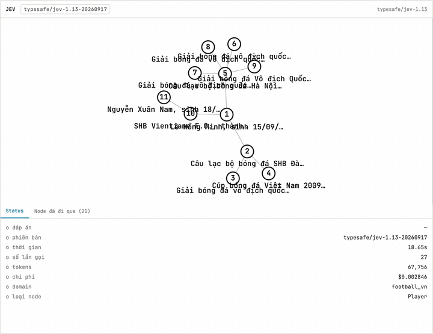
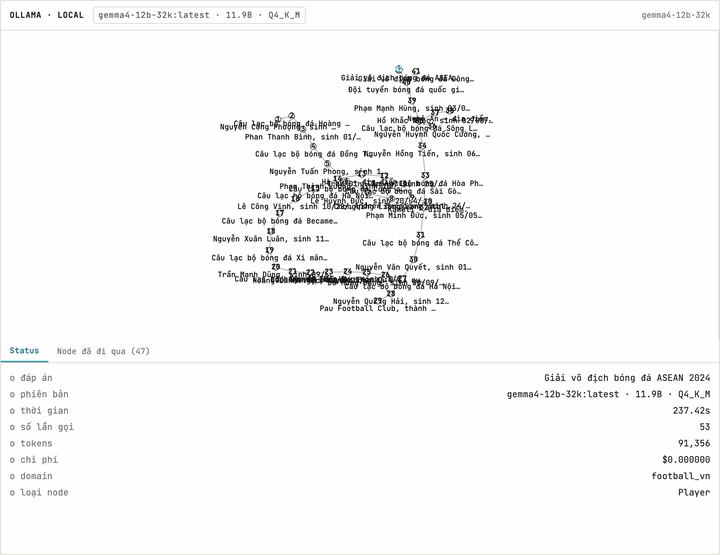
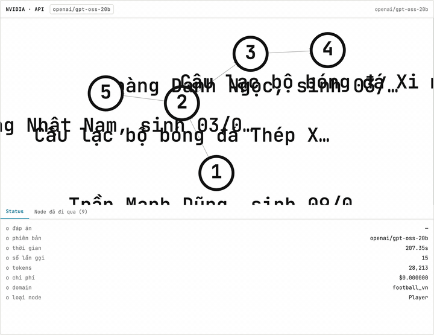
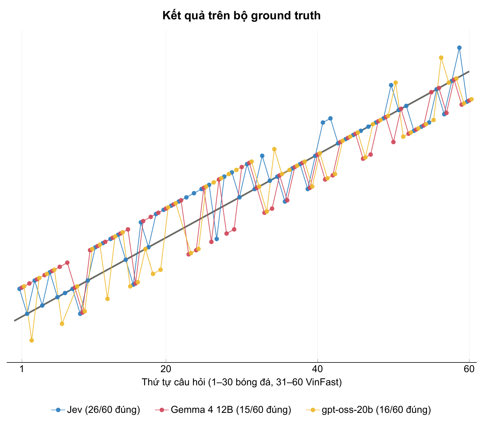
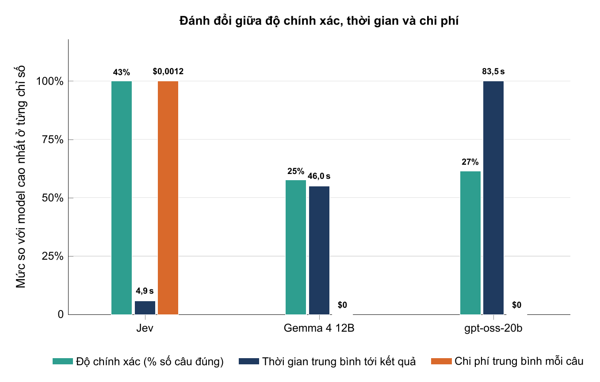

# Hopwise

> Liệu có thể dạy một mô hình quyết định đi đúng đường trên một Knowledge Graph, nhanh và rẻ hơn một LLM thông thường, mà vẫn chính xác không kém?

**Hopwise** là một thử nghiệm xoay quanh câu hỏi đó. Ý tưởng cốt lõi:
**Jev** — mô hình "System One" của TypeSafe, trả về quyết định có kiểu kèm xác suất thay vì sinh văn bản — để truy vấn một **Knowledge Graph**. Ở mỗi node, model được hỏi *"cạnh nào nên đi tiếp để tìm thông tin trả lời câu hỏi?"*, và quyết định đó được so sánh với việc giao hẳn câu hỏi cho một LLM thông thường (GPT, Claude, Gemini...) trên cùng bài toán — đối chiếu độ chính xác, tốc độ phản hồi và chi phí giữa hai cách tiếp cận.

<table>
  <tr>
    <th align="center">Jev</th>
    <th align="center">Gemma 4 12B (Ollama)</th>
    <th align="center">gpt-oss-20b (NVIDIA)</th>
  </tr>
  <tr>
    <td></td>
    <td></td>
    <td></td>
  </tr>
</table>

| Model | Loại | Môi trường |
|---|---|---|
| **Jev 1.13** (`typesafe/jev-1.13-20260917`) | System 1 — quyết định có kiểu + xác suất | TypeSafe, qua OpenRouter |
| **Gemma 4 12B** (`gemma4-12b-32k`, Q4_K_M) | System 2 — LLM thông thường | Local (Ollama), tắt suy luận |
| **gpt-oss-20b** | System 2 — LLM thông thường | NVIDIA NIM (cloud) |

## Đóng góp

| Nội dung | Trạng thái |
|---|---|
| Bộ dữ liệu Knowledge Graph crawl từ nguồn thật (Wikidata, SEC EDGAR) |  Có sẵn trong `data/` |
| Biểu đồ benchmark Jev so với các LLM khác (vẽ bằng TikZ, xuất ảnh) |  Có — xem [Kết quả benchmark](#kết-quả-benchmark) |
| Hướng dẫn xây một Knowledge Graph — cách các node quan hệ với nhau |  Chưa có trong bản này — xem [TODO.md](TODO.md) |

## Kết quả benchmark

Ba model trả lời **60 câu hỏi ground truth** (30 bóng đá + 30 VinFast, sinh tự động từ graph —
xem [benchmarks/README.md](benchmarks/README.md)). Mỗi model tự tìm điểm vào rồi đi theo cạnh trên
Knowledge Graph trong Neo4j, tối đa **5 phút mỗi câu**, chạy 1 lần mỗi câu.

**Tóm tắt kết quả: độ chính xác, thời gian và chi phí của 3 model trên 60 câu**

| | Jev | Gemma 4 12B | gpt-oss-20b |
|---|---|---|---|
| **Độ chính xác** | **26 (43%)** | 15 (25%) | 16 (27%) |
| Thời gian trung vị | 4,2 giây | 6,0 giây | 48,2 giây |
| Thời gian trung bình tới kết quả | 4,9 giây | 46,0 giây | 83,5 giây |
| Tổng số lần gọi model | 634 | 1.002 | 426 |
| Chi phí | $0,071 | $0 (chạy local) | $0 (API không báo chi phí) |





## Cấu trúc dự án

```
data/                   Knowledge Graph đã crawl (Wikidata, SEC EDGAR)
scripts/                Script crawl và kiểm tra dữ liệu
skills/typesafe-ai/     Tài liệu tham khảo để build với TypeSafe/Jev
frontend/               React + Vite + Tailwind: trang Graph (toàn bộ graph) và Benchmark (3 model, lịch sử)
backend/                FastAPI: benchmark Jev / Gemma (Ollama) / gpt-oss (NVIDIA) trên Neo4j, chạy hàng loạt `run_cases.py`
benchmarks/             Bộ câu hỏi ground truth (sinh từ graph), kết quả, script vẽ biểu đồ TikZ và làm GIF
docs/images/            Biểu đồ và GIF dùng trong README
docker-compose.yml      Neo4j (chạy bằng `docker compose up -d`)
.github/workflows/      CI: verify data, test backend, test frontend
.env.example            Mẫu biến môi trường (OpenRouter, TypeSafe, Neo4j)
```

## Tài liệu

| File | Nội dung |
|---|---|
| [GUIDE.md](GUIDE.md) | Cách chạy script và chạy toàn bộ project |
| [VERSION.md](VERSION.md) | Lộ trình các phiên bản |
| [TODO.md](TODO.md) | Những phần đã lên kế hoạch nhưng chưa có code |

## License

Mã nguồn: [Apache License 2.0](LICENSE). Dữ liệu trong `data/`: xem
[`data/README.md`](data/README.md) (Wikidata CC0, SEC EDGAR public domain).
